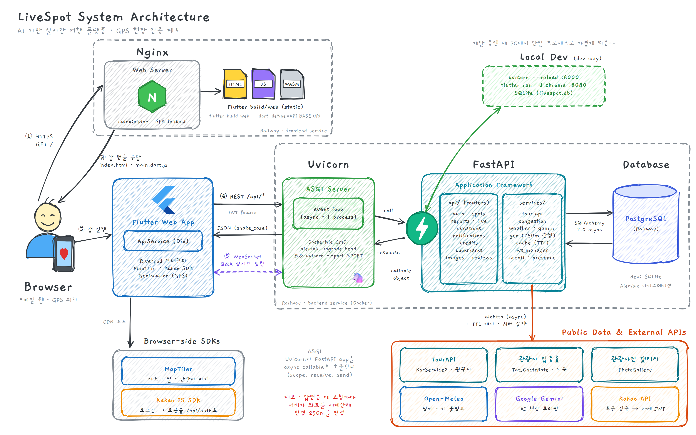

# 🗺️ LiveSpot

> 여행지의 **'지금'**을 알려주는 AI 기반 실시간 여행 플랫폼

[](https://flutter.dev)
[](https://fastapi.tiangolo.com)
[](https://www.sqlalchemy.org)
[](https://www.data.go.kr)



---

## 무엇을 하는 앱인가

관광지 정보는 공공데이터(한국관광공사 TourAPI)에서 실시간으로 가져오고, 그 위에 **GPS로 현장 인증된 사용자의 제보**를 얹어 "지금 그곳이 어떤지"를 보여준다.

**핵심 차별점 — 현장에 있는 사람만 쓸 수 있다.** 관광지 반경 250m 안에서만 제보·답변이 저장되고, 서버가 매 요청마다 좌표를 다시 계산해 판정한다.

---

## 주요 기능

| 기능 | 설명 | 상태 |
|---|---|---|
| 🗺️ **실시간 지도** | MapTiler 지도에 관광지 마커. 색상은 방문 집중률 예측 (🟢여유 / 🟡보통 / 🔴높음) | ✅ |
| 📍 **GPS 인증 제보** | 반경 250m 이내에서만 혼잡도·대기시간·주차 상황 제보 | ✅ |
| 🔴 **LIVE 상태창** | 최근 2시간 제보 건수 + 당일 현재 상황. 실시간 계산 | ✅ |
| 🔥 **핫스팟 랭킹** | 실제 제보가 있는 곳 우선, 부족하면 집중률 예측으로 채움 | ✅ |
| 💬 **현장 Q&A** | 멀리 있는 사람이 묻고, **현장 인증된 사람만** 답한다 (TTL 2시간) | ✅ |
| 📩 **질문/답변 알림** | 현장에 질문이 올라오거나 내 질문에 답이 달리면 인앱 모달로 즉시 알림 (WebSocket, 끊기면 폴링 폴백) | ✅ |
| 🔔 **제보 유도 알림** | 알림 켠 관광지 150m 안에 들어오면 알림 (앱 실행 중일 때만) | ✅ |
| 🌤️ **날씨** | Open-Meteo 기반 실시간 날씨 배지, API 키 불필요 (상세페이지 헤더) | ✅ |
| 🤖 **AI 브리핑** | Gemini 기반 현장 요약. 예측(집중률)·실측(제보)을 섞지 않고 별도 라벨로 제시. 1시간 이내 연속 제보는 최빈값으로 종합해 반영 | ✅ |
| 💎 **Credit 보상** | 제보 +10 / 답변 +5. 누적 Credit에 따라 새싹🌱~마스터👑 5단계 뱃지 자동 부여 (현금성 리워드·교환은 범위 밖) | ✅ |
| 🔐 **카카오 로그인** | 카카오로 로그인 → 서버가 자체 JWT 발급, 로그인 상태 유지. 앱 전용 unique 닉네임을 직접 설정(카카오 닉네임·프로필사진 미사용) | ✅ |

---

## 기술 스택

| 영역 | 기술 |
|---|---|
| 프론트엔드 | Flutter 3.x (웹) + Riverpod + Dio |
| 백엔드 | Python FastAPI (async) |
| DB | SQLAlchemy 2.0 + Alembic — 로컬 SQLite, 배포 PostgreSQL |
| 지도 | MapTiler SDK JS (`web/index.html`에서 CDN 로드) |
| 공공데이터 | TourAPI(KorService2), 관광지 집중률(TatsCnctrRateService), 관광사진 갤러리 |
| AI · 날씨 | Google Gemini, Open-Meteo(날씨 연동 완료, API 키 불필요) |
| 인증 | 카카오 로그인 + 서비스 자체 JWT (`PyJWT`) |
| 배포 | Railway — 백엔드(FastAPI, Postgres) + 프론트(Flutter 웹, nginx) 각각 컨테이너로 배포 |

---

## 프로젝트 구조

```
livespot/
├── livespot_app/              # Flutter 웹앱
│   └── lib/
│       ├── config/            # 테마, 상수, 라우트
│       ├── models/            # 서버 JSON → Dart 객체 (fromJson)
│       ├── services/          # api_service.dart 가 서버 호출 전담
│       ├── screens/           # 지도 · 라이브 · 상세 · 마이
│       └── widgets/           # 제보 모달, Q&A, 배지 등
│
├── livespot_backend/          # FastAPI
│   └── app/
│       ├── api/               # 라우터 (spots, reports, live, questions, notifications, credits, bookmarks, auth 등)
│       ├── db/models/         # SQLAlchemy 테이블
│       ├── models/schemas.py  # Pydantic 응답 스키마
│       └── services/          # TourAPI, 집중률, 지오, 캐시
│
├── docs/worklogs/             # 📓 기능별 작업일지 — 무엇을 왜 만들었는지
├── function.md                # 설계서 (전체 지도 + 미구현 기능 설계)
├── run.md                     # 실행 명령
└── CLAUDE.md                  # 개발 하네스 설정
```

---

## 시작하기

### 바로 써보기
👉 **https://livespot.kr**

설치할 것 없이 브라우저로 접속하면 된다. 제보·답변은 GPS 판정이 있어서 **휴대폰 브라우저**로 관광지 반경 250m 안에서 접속해야 쓸 수 있다(노트북은 위치 오차 때문에 통과하지 못한다). 제보와 답변을 쓰려면 카카오로 로그인하고 닉네임을 설정해야 한다.
